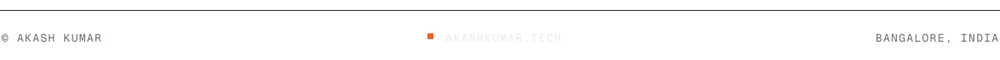

&nbsp;
&nbsp;

  

  

  

  

<picture>
  <source media="(prefers-color-scheme: dark)" srcset="https://raw.githubusercontent.com/Akash-kumar-2021/Akash-kumar-2021/output/snake-dark.svg" />
  <source media="(prefers-color-scheme: light)" srcset="https://raw.githubusercontent.com/Akash-kumar-2021/Akash-kumar-2021/output/snake-light.svg" />
  
</picture>

