  

  
  
  
  

  

  

## ⚡ Tech stack

    
  

  
  
  
  
  
  
  
  
  

## 🛰️ What I've shipped

<table>
  <tr>
    <td width="50%" valign="top">
      <h3>🏢 Intechive Systems</h3>
      Software Engineer · Bangalore · October 2025 – present
      <ul>
        <li>Admin analytics dashboard for a public sector platform, with interactive charts and date-range filtering</li>
        <li>Role-based authentication and permission-driven UI</li>
        <li>Patient-facing mobile app: phone login, secure PIN, multi-device sessions, text and voice chat</li>
        <li>Field-worker mobile app with onboarding, QR-code workflows and alerts</li>
      </ul>
    </td>
    <td width="50%" valign="top">
      <h3>🤖 Xane AI</h3>
      Frontend Developer · Gurgaon · September 2022 – May 2025
      <ul>
        <li>Built about <b>70%</b> of the frontend for the workflow and template platform (form automation)</li>
        <li>Delivered a vision-analysis UI module in <b>2 weeks</b></li>
        <li>Progressive Web App proof of concept for paint saturation analysis</li>
        <li>Company website built from scratch, with Rive animations</li>
      </ul>
    </td>
  </tr>
</table>

## 📡 GitHub activity

  
  

  

  

  <picture>
    <source media="(prefers-color-scheme: dark)" srcset="https://raw.githubusercontent.com/Akash-kumar-2021/Akash-kumar-2021/output/snake-dark.svg" />
    <source media="(prefers-color-scheme: light)" srcset="https://raw.githubusercontent.com/Akash-kumar-2021/Akash-kumar-2021/output/snake-light.svg" />
    
  </picture>

❯ open to frontend and React Native engineering roles, and freelance projects · <a href="https://akashkumar.tech/">akashkumar.tech</a>

